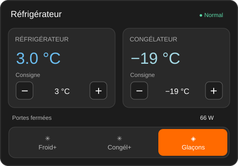

# Fridge Card for Home Assistant

A reusable Home Assistant Lovelace card with **two side-by-side circular thermostat controls** for refrigerator and freezer, measured temperatures, door state, power usage, and optional modes. The controls reuse Home Assistant's own `ha-control-circular-slider`, `ha-big-number`, and `ha-outlined-icon-button` web components.

**Status: v0.7.0 development prototype.** The UI has been tested with simulated states, but has **been installed for live Home Assistant testing; visual/device-level testing is still pending**. Please test it as a custom repository before creating a public release.



## Visual editor (v0.7.0 development build)

**No YAML required for normal setup.** In Home Assistant's Dashboard edit mode, choose **Edit card** to open the graphical editor. It includes native searchable entity pickers, customizable colors (pickers and CSS inputs), appearance controls, visibility switches and localizable labels. You can also add custom toggle modes and tune the native two-dial thermostat layout.

**48 configurable fields** are currently exposed in the visual editor. Full reference: **[Configuration guide](docs/configuration.md)**.

Existing YAML is kept compatible. These are experimental builds; real-browser testing and cross-version validation are required before a stable HACS release.

## Install (development branch)

1. In **HACS / Marketplace**, add this repository as a **custom Dashboard repository**:
   `https://github.com/Sr-0w/lovelace-fridge-card`
2. Install **Fridge Card**.
3. Reload Home Assistant in your browser.
4. If the resource was not registered automatically, add `/hacsfiles/lovelace-fridge-card/fridge-card.js` as a **JavaScript module** in **Settings → Dashboards → Resources**.
5. Add a **Manual** dashboard card and configure your entities.

## Example

```yaml
type: custom:fridge-card
name: Réfrigérateur
detail_path: /dashboard-maison/cuisine-frigo
entities:
  fridge_temperature: sensor.my_fridge_temperature
  freezer_temperature: sensor.my_freezer_temperature
  fridge_setpoint: number.my_fridge_set_temperature
  freezer_setpoint: number.my_freezer_set_temperature
  fridge_door: binary_sensor.my_fridge_door
  freezer_door: binary_sensor.my_freezer_door
  power: sensor.my_fridge_power
  filter_usage: sensor.my_water_filter_usage
  quick_cool: switch.my_fridge_power_cool
  quick_freeze: switch.my_freezer_power_freeze
  ice: switch.my_ice_maker
labels:
  refrigerator: Réfrigérateur
  freezer: Congélateur
  setpoint: Consigne
  door_open: Porte ouverte
  doors_closed: Portes fermées
  filter: Filtre
  quick_cool: Froid+
  quick_freeze: Congél+
  ice: Glaçons
```

The three optional Power cool / Power freeze / Ice switches appear as a **thermostat-style segmented control** with an orange background for each active switch. They are independent switches: selecting one does not automatically disable another.

Only `fridge_temperature` **or** `freezer_temperature` is required. All other entities are optional; absent controls are hidden. Two temperature dials remain visible **side by side**, one per compartment, each showing the target in the native `ha-big-number` display and the measured temperature below. The native outlined −/+ buttons and circular sliders respect the mapped `number.*` entity's `min`, `max`, and `step` attributes. The card reuses Home Assistant's frontend `<ha-control-circular-slider>` with the `min`, `max`, and `step` limits from that number entity; a small dot marks the measured temperature. Changes are sent using `number.set_value` **only after the user releases the slider**. The matching −/+ controls also change the setpoint one supported step at a time; no device is changed automatically. Door binary sensors are expected to be `on` when open, and the optional filter sensor must report **percentage used**. Power is shown in watts. `quick_cool`, `quick_freeze`, and `ice` must be switch entities.

The configurable `detail_path` links to an **existing** Home Assistant view; the card does not create that view. With no detail path, the button opens entity more-info.

### Frontend compatibility

**Important for future HACS catalog releases:** `ha-control-circular-slider` is an internal component of Home Assistant's frontend, not a separately versioned public card API. It is used by the built-in thermostat, but may be lazy-loaded or changed in other HA versions. The card includes a visual fallback and still offers the −/+ buttons if the native element has not loaded. Test on devices without an existing thermostat card before publishing a stable release. No custom climate entity is required: temperature targets remain ordinary `number.*` entities.

## Portability and permissions

All entity IDs are supplied in YAML. There is **no manufacturer SDK**, no backend service, and no network request outside Home Assistant's built-in card interface. Mode actions use `hass.callService('switch', 'toggle', ...)`; temperature controls use `hass.callService('number', 'set_value', ...)`. Both use the current Home Assistant user's permissions.

## Planned before HACS catalog submission

- Live validation on different Home Assistant versions and phone/tablet/desktop layouts
- GUI editor and translations
- Better availability/error handling and configurable thresholds/units
- Tests, accessibility checks, and tagged releases

MIT license. Contributions welcome.