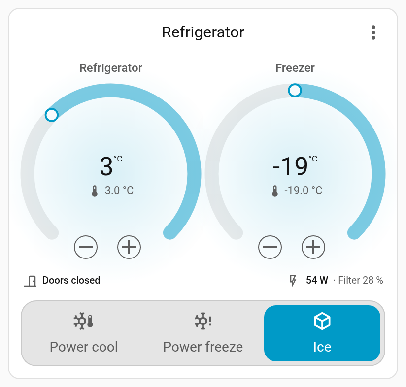
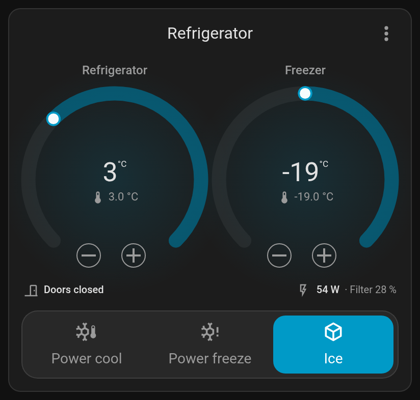
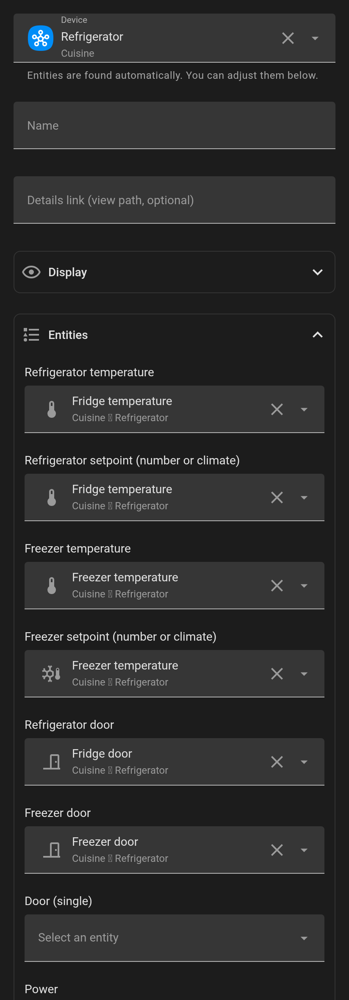

# Fridge Card

A Home Assistant dashboard card for refrigerators and freezers: one thermostat
dial per compartment, built from Home Assistant's own thermostat controls, with
doors, temperature alerts, filter, power and quick modes (power cool, power
freeze, ice maker…).

<p align="center">
  
  
</p>

## Features

- **Pick the device, done.** Choose your refrigerator in the card editor: its
  temperatures, setpoints, doors, filter, power and mode switches are found
  automatically. You can still change any of them.
- **Native dials.** The same circular slider and − / + buttons as Home
  Assistant's thermostat card, limited to what your appliance accepts. The
  setpoint is sent when you release the dial. A dot marks the measured
  temperature.
- **Any appliance shape.** Refrigerator + freezer, refrigerator only, freezer
  only. Setpoints can be `number`, `input_number` or `climate` entities; without
  a setpoint the measured temperature is shown read-only.
- **Alerts.** Door open, too warm, to watch, filter to replace. Thresholds
  follow your sensors' unit (°C or °F) and can be changed.
- **Quick modes** as a segmented control: power cool, power freeze, ice maker,
  plus any extra switch you add (vacation, eco…).
- **Visual editor** with Home Assistant's own pickers: device, entities, theme
  colours, icons, sliders. No YAML needed.
- **Translations:** English, French, German, Dutch, Spanish, Italian (every text
  can be overridden).

## Compatibility

The card only talks to Home Assistant entities, so it works with any
integration. Automatic discovery was written for:

| Integration | Discovery | Notes |
| --- | --- | --- |
| SmartThings (Samsung) | Tested | Temperatures, setpoints, doors, filter, power cool / power freeze / ice maker. |
| Home Connect (Bosch, Siemens, Neff, Gaggenau) | Designed for | Setpoints, super modes, doors. |
| Miele | Designed for | Temperature, target temperature, superfreezing / supercooling. |
| LG ThinQ and others with `climate` entities | Designed for | Setpoint and measured temperature from the climate entity. |
| Anything else | Manual | Map the entities in the editor. |

"Designed for" means the card was checked against those integrations' entity
names, not on a real appliance. Reports and screenshots are very welcome.

The dials use Home Assistant's `ha-control-circular-slider`, the element of the
built-in thermostat card. If a future Home Assistant changes it, the card falls
back to a static ring and keeps its − / + buttons.

Requires Home Assistant 2024.8 or newer.

## Installation

### HACS

[](https://my.home-assistant.io/redirect/hacs_repository/?owner=Sr-0w&repository=lovelace-fridge-card&category=plugin)

1. Open HACS, search for **Fridge Card** and download it.
   If it is not listed yet, add `https://github.com/Sr-0w/lovelace-fridge-card`
   as a custom repository of type **Dashboard** first.
2. Reload your browser.

### Manual

Copy `dist/fridge-card.js` to `config/www/`, then add `/local/fridge-card.js`
as a **JavaScript module** in **Settings → Dashboards → ⋮ → Resources**.

## Configuration



Add the card from the dashboard editor (search for *Fridge*) and pick your
refrigerator.

In YAML, the shortest configuration is the device alone; entities you list
override what is found:

```yaml
type: custom:fridge-card
device: f24f48b661928c3f5fc6735adc38b9a7
```

A fuller example:

```yaml
type: custom:fridge-card
name: Refrigerator
device: f24f48b661928c3f5fc6735adc38b9a7
entities:
  power: sensor.fridge_plug_power        # e.g. from a smart plug
extra_modes:
  - entity: switch.fridge_vacation_mode
    label: Vacation
    icon: mdi:airplane
colors:
  accent: light-blue                     # a theme colour name, #hex or var(--…)
fridge_warn: 7
freezer_warn: -15
```

See the [configuration reference](docs/configuration.md) for every option.

## Privacy and permissions

The card runs in your browser and only uses Home Assistant's own API, with the
permissions of the logged-in user. No network requests, no tracking.

## License

MIT
